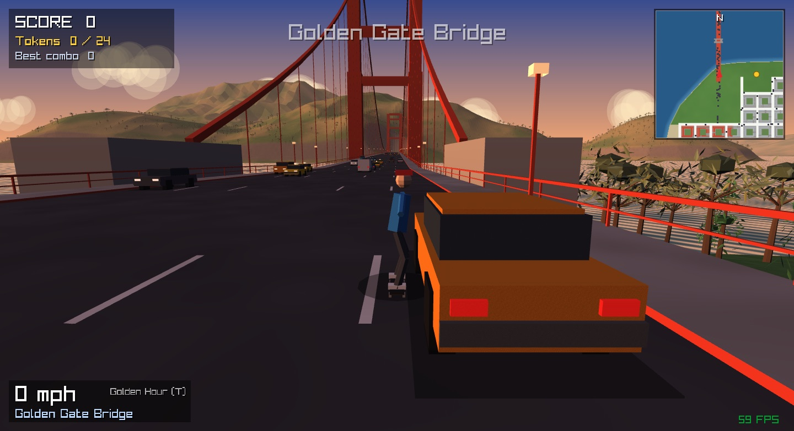
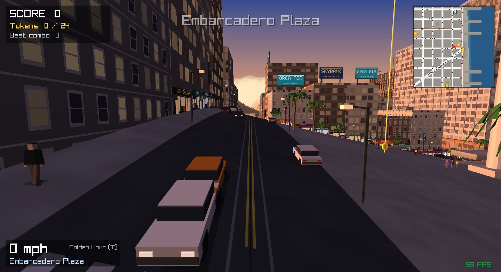
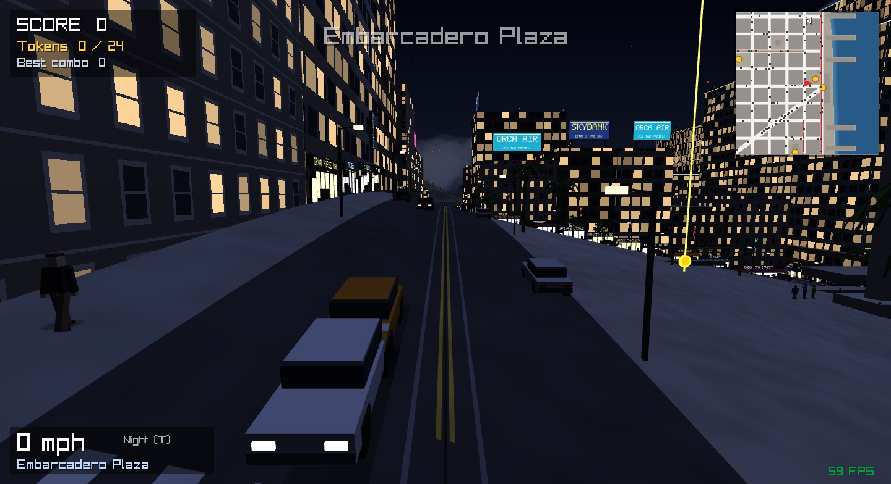
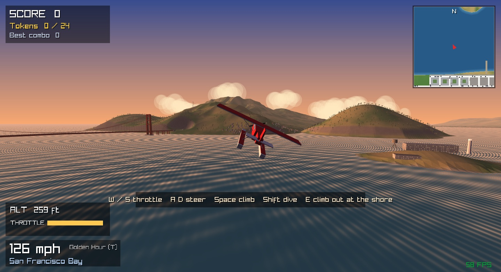
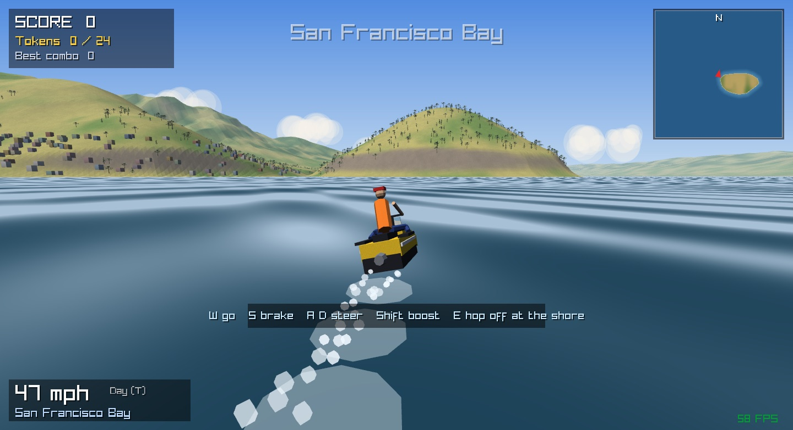
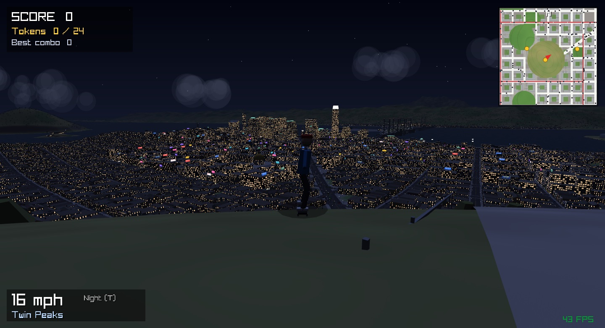
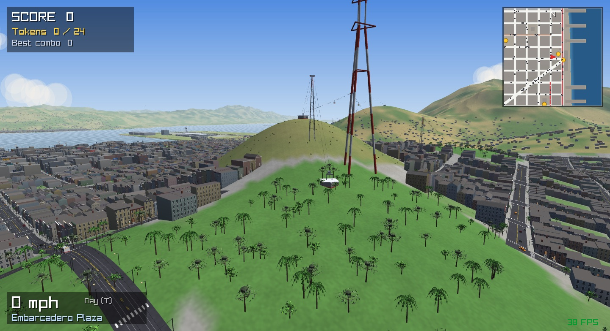
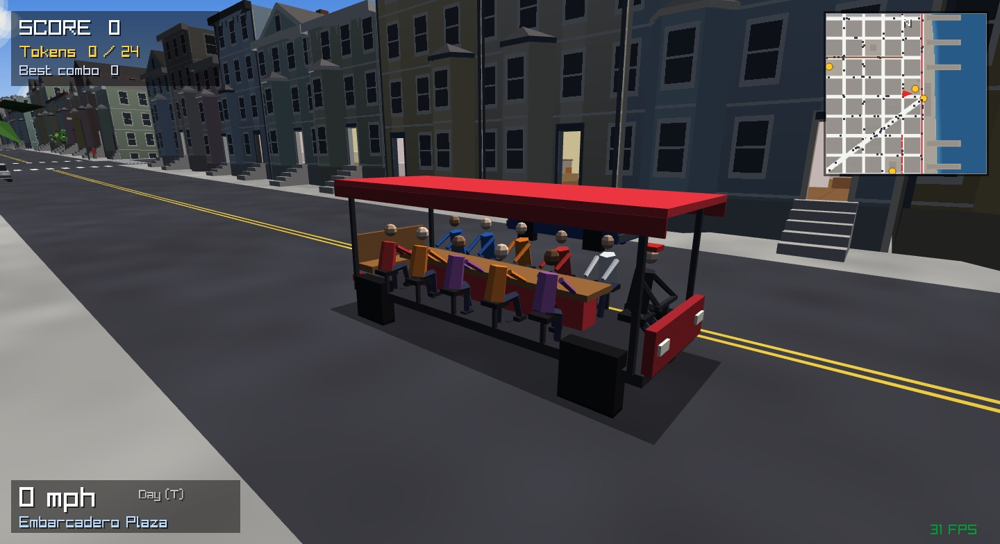
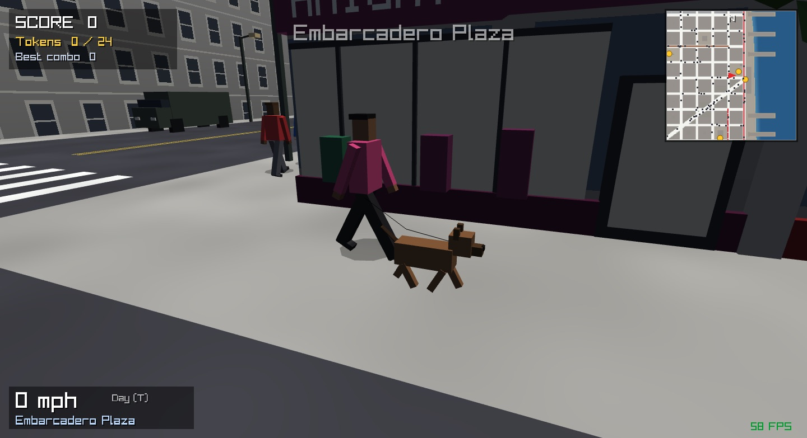
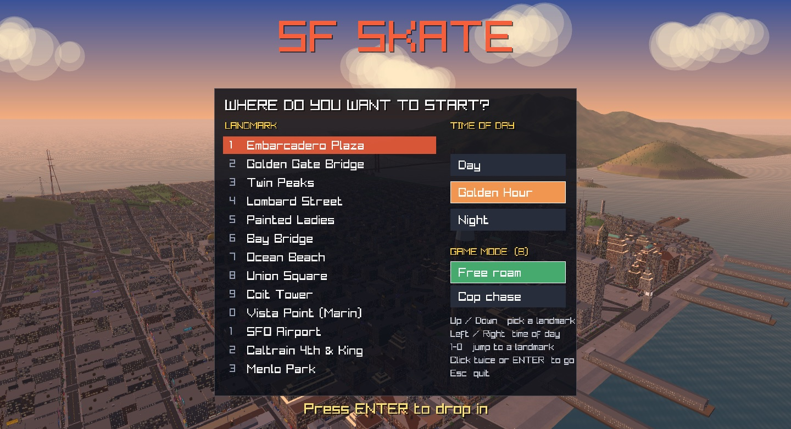

# SF Skate

A 3D skateboarding game in C++ set in a stylized San Francisco. Skate down Twin Peaks, across the Golden Gate and Bay Bridges, down Lombard Street, and through the Financial District. There's traffic, cable cars, pedestrians, and views across the bay.



## Screenshots

| | |
|---|---|
|  |  |
| **Downtown at golden hour:** shops with lettered signs, rooftop billboards, traffic | **The same street at night:** lit windows, glowing signs and billboards |
|  |  |
| **Seaplane:** take off from the water and fly over the bay | **Jet ski:** find one moored on the shore and ride the bay |
|  |  |
| **Twin Peaks at night:** the whole city lit up below, downtown and the Bay Bridge beyond | **Gondolas** over the hills, by Sutro Tower |
|  |  |
| **Pedal buses** crawling through North Beach | **Dog walkers** (and cats on the stoops) |



## Build & run (macOS)

```sh
brew install raylib   # one-time
make run
```

`make test` runs the headless gameplay checks (physics, tricks, grinds, collisions, spawn points).

## Controls

| Key | Action |
|---|---|
| W / ↑ | push |
| S / ↓ | brake |
| A / D | steer (spin while in the air) |
| Shift | tuck (less drag, faster downhill) |
| Space | ollie / jump off a rail |
| J / K / L | kickflip / heelflip / pop shove-it (in the air) |
| I (hold) | grab |
| Right mouse + drag | look around; wheel zooms; C changes the camera |
| Tab | choose a landmark and time of day (also shown at start) |
| E | ride Caltrain (at a station), or hop on / off a jet ski |
| M | map |
| 1–0 | teleport to a landmark (SFO Airport is in the Tab menu) |
| T, or F1 / F2 / F3 | time of day (day, golden hour, night), anytime while skating |
| F | Karl the Fog |
| G | rain on / off (the streets take a while to soak and to dry) |
| V | graphics quality: High (two sun-shadow cascades, bloom), Medium (one cascade), Low (no sun shadows or bloom, fastest) |
| R | reset to the last safe spot |
| P | pause |
| B | free roam / cop chase mode |
| N | police difficulty: easy, normal, hard |
| H | show/hide help |

Land on rails, ledges, ramp coping, or the bridge railings to grind; tap A/D to keep your balance. Every trick in a combo adds to the multiplier. If you land sideways, finish a flip too late, or hit a car, you bail. There are gold tokens at landmarks around the city.

**Landing:** hard landings bounce: the board pops back up in a small hop that you can flip out of. A clean, lined-up landing is a STOMP (+15% on the combo); a crooked or high one is sketchy (-20%, and you lose speed). The camera dips on a hard landing.

**Houses:** about nine in ten Victorian and Edwardian houses (13,900 of them) have an open front door. On hills they have tall front steps, and on the steepest streets a flight of stairs with a handrail runs along the front up to a landing at the door. Inside there's a hall, a front room with a sofa, fireplace, TV and bookshelf, and a back room with a table, kitchen counter, fridge and stove, with wainscoting, curtains, lamps and a ceiling you can bonk your head on. Rooms are warm and lit, brighter at night. In a tight room the camera swings round to the side with the most space. Houses with a closed door are on very narrow lots or the steepest ground.

**Police chase:** every so often a patrol spots you (a siren, flashing screen edges, red dots on the minimap and a pointer arrow to the closest cop). Cruisers lead their aim to cut you off, and every 18 seconds of chase adds a star, up to five, with roadblocks from the front from two stars. When you slow down or duck into a house, officers get out of their cruisers and run you down on foot. They go through front doors too. Skate into an officer at speed (about 19 mph or more) and you bowl them over for +250.

**Fighting a cop:** if an officer catches you at low speed it turns into a struggle. Mash SPACE and A / D to pull free, or swing the board with J / K / L for a bigger push. Fill the bar and you shove them down, get a head start and a couple of seconds where nobody can grab you again, and the chase goes on. Let it empty (or let more officers pile in) and you're busted: fined, and sent back to your last safe spot. Bailing near a cop gets you busted faster.

**Losing them:** get 150 m clear and stay clear for 5 seconds to score 700 per star plus a bonus for the chase and a quarter of your trick points. The start screen (and Tab mid-game) has a game mode: **Free roam** (no police, just skate) or **Cop chase**; B flips between them anytime. N to switch the difficulty (easy, normal or hard: cop speed, how fast heat builds, and how hard they hold on).

**Jet skis:** nine of them are moored along the shore of the bay and the ocean, spread far apart, and nothing marks them, so you have to go looking. Walk up to one and press E. W throttles, S brakes, A / D steer, Shift boosts (about 65 mph). You stay on the water: shores, piers and bridge piers stop you. Press E near the shore to hop off; the ski stays where you left it. The police stand down while you ride.

**Seaplanes:** only three in the whole map, moored in particular spots: off the north waterfront near the Wharf, on the Marin shore across the Golden Gate, and on the bay by SFO. Walk up and press E to climb in. W / S set the throttle (it stays where you leave it), A / D steer on the water and bank in the air, Space pulls the nose up (lift off past about 55 mph), Shift pushes it down. Below about 42 mph in the air it stalls and the nose drops. Land on the water gently (wings level, not diving steeply, under about 105 mph), then taxi to the shore and press E to climb out. Hit the ground, a building or the water too hard and you crash: the plane is towed back to its mooring and you're put back where you climbed in. Two more planes circle the bay overhead with a pilot and passengers aboard.

## Look and atmosphere

- **Sun shadows**: buildings, trees, lamps, cars, people and the skater cast real shadows from the sun, long and warm at golden hour and faint blue moon shadows at night. Two shadow cascades follow the camera (a sharp one close up, a wider one out to about 250 m).
- **Lighting**: hills, tree trunks, domes and palm fronds shade smoothly while buildings keep crisp edges; tree canopies are lit as soft volumes. Walls, poles, trunks and parked cars darken where they meet the ground.
- **Surfaces**: asphalt with cracks, patches and oil stains; sidewalks and plazas in slabs with joints; grass in lush and dry patches; clapboard siding on the Victorians, brick bond on brick buildings, floor seams on concrete.
- **Haze and post-processing**: the city is drawn off-screen and finished in a post pass: height haze that pools low and thins over the hilltops (and Karl the Fog really does sit in the valleys), warm haze toward a low sun, bloom on lamps, signs, neon, lit windows and sun glints, a color grade for each time of day, and a speed blur at the edges of the screen when you're flying.
- **Rain** (G): grey overcast, rain streaks around you (not indoors), wet, darker streets with puddles that mirror the sky, ripples on the bay, city lights smeared across the wet asphalt at night.
- **Sound**: all synthesized. Traffic hum that grows with the cars around you, surf near open water, sea lions barking at Pier 39, wind on the bridges and hilltops, party music from a passing pedal bus, gulls crying, wings clattering, rain.

## What's in the city

- **Hills**: Twin Peaks, Nob Hill, Russian Hill, Telegraph Hill, Pacific Heights, Potrero, Bernal. The streets climb and drop at real SF grades.
- **Landmarks**: Golden Gate Bridge (skateable, with Vista Point), Bay Bridge out to Yerba Buena Island and Oakland, Transamerica Pyramid, Salesforce Tower, Coit Tower, Ferry Building, Painted Ladies, Lombard's switchbacks, City Hall, Palace of Fine Arts, Sutro Tower, Oracle Park, Pier 39 with sea lions, Alcatraz, the Port of Oakland cranes, and Golden Gate Park with the Dutch windmill.
- **Downtown towers** glow at night: floodlit setbacks and copper crowns on the Art Deco ones, blue LED crowns on the glass slabs, ringed needles, lit rooftop signs and helipad lights.
- **Neighborhoods** each have their own style: towers in FiDi, Victorians in the Western Addition (many with a real front door you can skate through), colorful rowhouses in the Mission, and pastel boxes in the Sunset.
- **Muni Metro**: the N Judah, L Taraval, J Church, K Ingleside, T Third and E Embarcadero streetcar lines, with tracks, overhead wires and trains that stop along the way (red lines on the map).
- **SFO Airport**: on a raised plateau at the edge of the bay, ringed by mountains: San Bruno Mountain and Sweeney Ridge to the west (with the "SOUTH SAN FRANCISCO THE INDUSTRIAL CITY" hillside sign), the Santa Cruz Mountains to the south, and the East Bay hills and Mount Diablo hazy across the water. It has runway markings and lights, approach lights on pylons out in the bay, a rock seawall, the terminal with a curved roof and an elevated departures road, a flared control tower, gates with parked jets and ground crews, a moving AirTrain, the San Mateo Bridge in the distance, and a jet taking off while another lands. It's also a start point.
- **Caltrain**: a double-track electrified line from 4th & King down the Peninsula past SFO, Millbrae, San Mateo and Redwood City to Menlo Park. Trains run the line and stop at each station. Stand on a platform and press E to ride (Space skips to arrival).
- **Menlo Park**: oak-lined streets of big homes with lawns, hedges, driveways and pools; downtown Santa Cruz Avenue; El Camino Real; the yellow 1867 depot; a bayfront tech campus with a rooftop park and salt ponds; Stanford's Hoover Tower to the south; and the wooded hills of Woodside to the west.
- **People**: rounded heads with short or long hair, buns, curls or caps; backpacks, shoulder bags, shopping bags; plenty walking along staring at their phones. Standing people wait and look around, chat with their hands, take calls or fold their arms, and walkers sometimes wait at the corner before crossing. Detail drops off with distance so thousands of them stay cheap.
- **Street life**: traffic lights on the downtown, Mission and Wharf intersections cycle and the cars stop for them; four-way stop signs in the neighborhoods; fire hydrants, green trash cans, newspaper boxes, bike racks with bikes, dockless scooters and Muni shelters with lit ads along the curb (all solid, and kept clear of front doors); manhole covers, a few letting off steam.
- **Birds**: gulls wheel over the waterfront, the piers and Ocean Beach; pigeons peck around Union Square, Embarcadero Plaza and Civic Center and burst into the air when you skate through, circle, and settle back down.
- **Pets**: about one walker in ten has a dog on a leash (all sizes and coats, trotting ahead, tail wagging, sitting when the owner stops). About 440 cats sit or loaf on the front steps of the Victorians, grooming now and then, and they bolt if you skate at them.
- **Traffic**: cars, taxis, Muni buses, pedal buses (party bikes with ten riders pedalling round a bar, crawling along the flatter streets of the north side and holding up the cars behind), two cable car lines, and F-line streetcars on Market Street. Cars stop and honk if you're in the road.
- **Skate spots**: Embarcadero Plaza (ledges, stairs with handrails, funbox, kickers), Union Square, Civic Center lawns, and a mega kicker on Marina Green.

## Code layout

| File | Contents |
|---|---|
| `src/world_terrain.cpp` | coastlines, hills, zones, collision queries, ground mesh, minimap, GPU upload (normals, layers) |
| `src/world_city.cpp` | streets, building blocks, Victorian fronts and house interiors, street furniture and clutter, intersections, parks |
| `src/world_towers.cpp` | downtown towers: Art Deco setbacks, faceted granite, glass slabs, mid-century, needles, brick |
| `src/world_landmarks.cpp` | bridges, landmarks, waterfront, skate spots, teleports, tokens |
| `src/player.cpp` | skate physics, tricks, grinds, bails, skater model |
| `src/chase.cpp` | police chase: cruisers, officers on foot, fights, busting and escaping |
| `src/traffic.cpp` | cars, cable cars, pedestrians, traffic signals |
| `src/birds.cpp` | gulls over the waterfront, pigeons in the plazas |
| `src/weather.cpp` | rain streaks and wetness, manhole steam |
| `src/render.cpp` | city shader (lighting, sun shadows, haze, surface detail, wet streets, water), shadow maps, off-screen scene, bloom / grading / speed blur |
| `src/seaplane.cpp` | seaplanes: moorings, taxi / takeoff / flight / landing, model, the two circling overhead |
| `src/jetski.cpp` | jet skis: shore placement, water physics, model, wake and spray |
| `src/audio.cpp` | synthesized sound (no audio files) |
| `src/main.cpp` | sky, time of day, camera, HUD, ambience mix, game loop |

The whole city is generated in code at startup. It uses no external art or sound assets. Static geometry is split into layers per 400 m cell: house interiors are only drawn near the camera, and beyond about 650 m each tree canopy is swapped for a low-poly blob.
